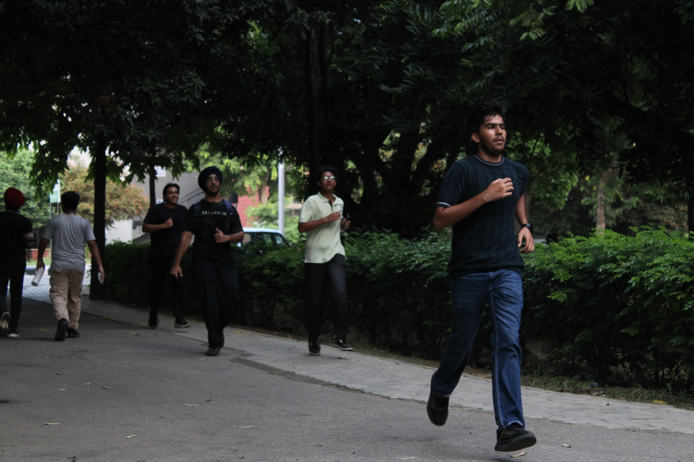
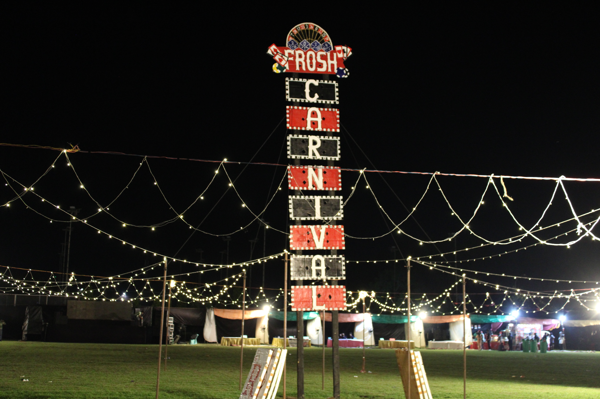
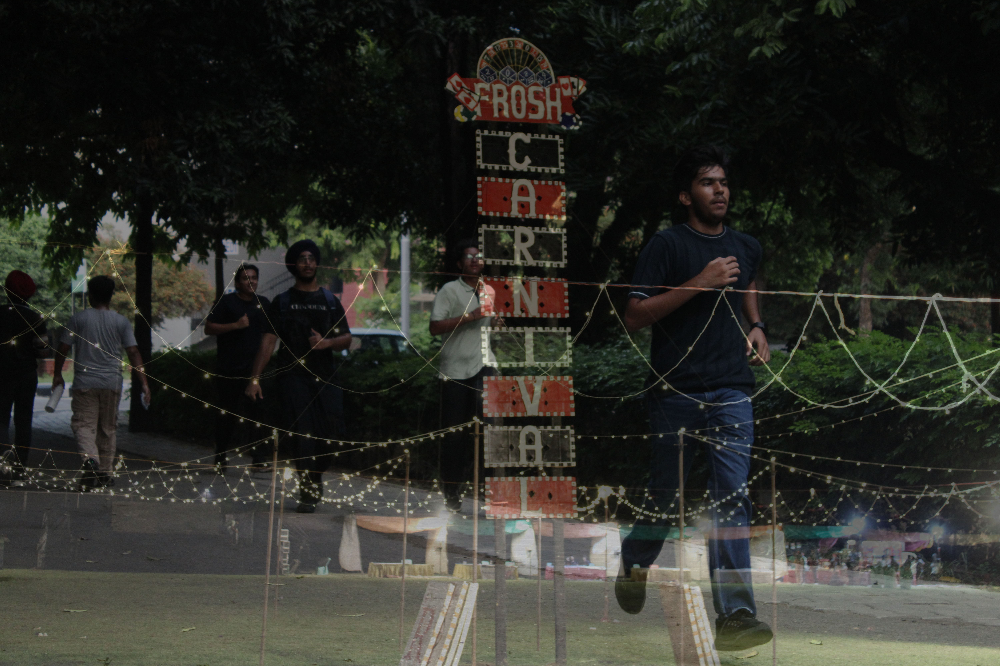
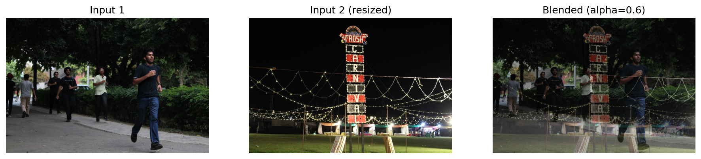

# Exercise 2 – Computer Vision: Image Blending using OpenCV

**Notebook:** `Exercise2._YourFullName.ipynb`

## Objective
Merge two images programmatically using weighted blending.

## Steps performed
1. Loaded two images with `cv2.imread` and checked that both loaded (OpenCV returns `None` for a bad path instead of raising an error).
2. Resized the second image to the first image's dimensions with `cv2.resize`. OpenCV expects the target size as (width, height).
3. Blended the images with `cv2.addWeighted(img1, 0.6, img2, 0.4, 0)`, which computes 0.6 × img1 + 0.4 × img2 for each pixel.
4. Converted from BGR to RGB for display in matplotlib, then saved both inputs and the blended output.

## Results
| Input 1 | Input 2 (resized) | Blended (α = 0.6) |
|---|---|---|
|  |  |  |

## Observations
- With α = 0.6 the first image dominates the composite, and the second appears as a semi-transparent overlay.
- Raising α toward 1 makes the output closer to Input 1; lowering it toward 0 makes it closer to Input 2.
- Image size used: [width × height] pixels.
