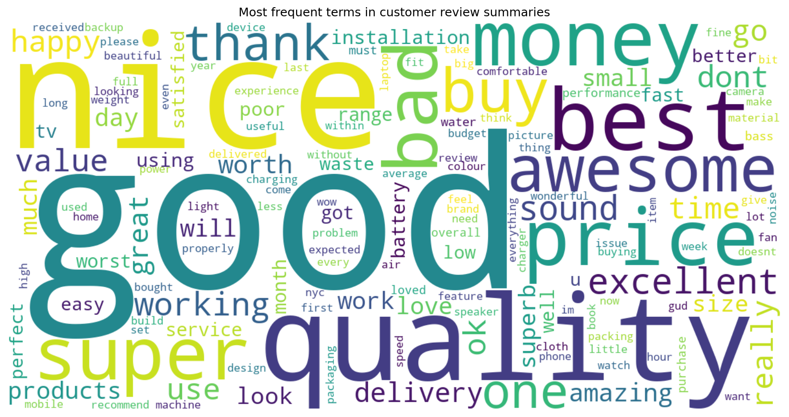

# Exercise 4 – E-Commerce Text & Quantitative Analytics

**Notebook:** `Exercise4._YourFullName.ipynb`

## Dataset
Flipkart Product Customer Reviews Dataset (Kaggle): [paste Kaggle URL]  
The dataset is not included in this repository. Download it from Kaggle and place the CSV in this folder to run the notebook.

## Steps performed
1. Loaded the CSV into a Pandas DataFrame and checked its columns and data types.
2. Cleaned the data:
   - Converted `Rate` to numeric; non-numeric entries became missing values and were dropped.
   - Removed currency symbols and commas from `product_price`, then converted it to numeric.
   - Kept only ratings between 1 and 5.
   - Rows: [raw count] before cleaning, [clean count] after.
3. Grouped by `product_name` and computed mean rating, mean price, and review count. Stored the result in the DataFrame `items`.
4. Generated a word cloud from the `Summary` column, after removing common stopwords.

## Results
- Number of unique products: [value]
- Product with the most reviews: [name], [count] reviews, mean rating [value]

## Observations
- Most frequent terms: [list the 4–5 largest words in your cloud]
- I added a review count to the summary table because a mean rating based on a handful of reviews is far less reliable than one based on hundreds.
