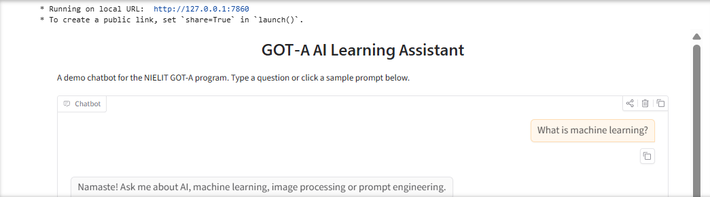

# Exercise 5 – Interactive AI Prototyping with Gradio

**Notebook:** `Exercise5._YourFullName.ipynb`

## Objective
Build and launch a web-based chatbot interface with Gradio.

## Implementation
- Built with `gr.ChatInterface`.
- **Title:** GOT-A AI Learning Assistant
- **Description:** a short welcome and usage note shown above the chat window.
- **Sample prompts:** "What is machine learning?", "How does image blending work?", "Give me tips for prompt engineering"
- **Response logic:** rule-based keyword matching over a small knowledge base of AI topics covered in the program. This approach needs no API key or model download, and no data leaves the local machine.

## How to run
```
pip install gradio
```
Run all cells in the notebook, then open http://127.0.0.1:7860 in a browser.

## Screenshot of the running interface


## Limitations and possible extension
- Responses are limited to predefined topics. Questions outside them get a fallback message.
- The same interface could be connected to a language model, by replacing the `respond` function, without changing the UI code.
